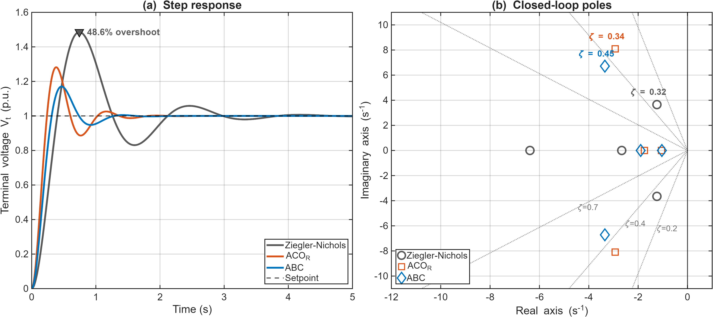
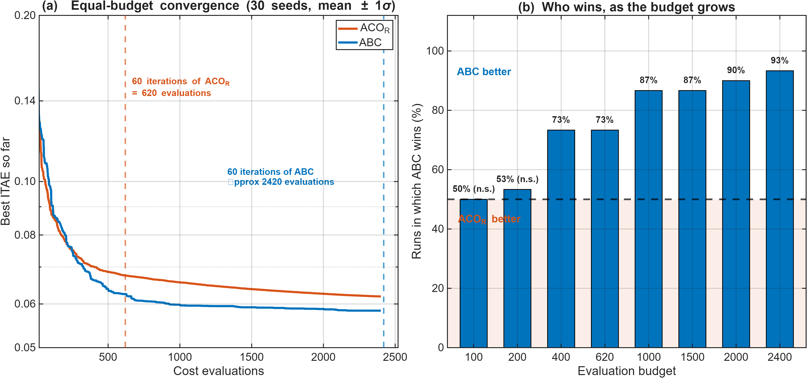

# pid tuning with aco and abc

tuning a pid controller for the avr system (the standard benchmark from gaing 2004) using two swarm algorithms, continuous ant colony (aco-r) and artificial bee colony (abc), and checking them against ziegler nichols.

the cost is the itae of the step response. you only get that by simulating it, theres no formula or gradient to work with... so a heuristic that just needs the number makes sense here.



## what came out

- both beat zn by a lot. abc gave Kp 0.772, Ki 0.527, Kd 0.252 -> itae 0.059 vs 0.516 for zn, overshoot 17% vs 48.6%
- the gains hold up with +-20% drift in the generator without retuning, and recover from a load step ~3x faster than zn
- comparing them by iterations isnt fair (aco-r does 10 evals per iteration, abc ~40). at the same number of evals abc still wins most runs but the gap is a lot smaller
- abc wins here because the itae surface is a narrow tilted valley, aco-r's search shrinks too fast and stalls in it
- with a small budget, more gains to tune or a delay in the loop, aco-r does better
- best design i found overall was Kp 0.641, Ki 0.440, Kd 0.206 (itae 0.0548, 10.6% overshoot)



## running it

needs matlab with the control system and statistics toolboxes. parallel toolbox is optional (makes the seed runs faster), simulink is only for the model.

```matlab
setup
run_all
```

`tune_pid.m` gives the main designs, the `exp*.m` files are the comparisons. everything goes into `results/`.

## folders

- `src/` plant, cost, zn, the two algorithms
- `experiments/` one script per study
- `simulink/` the avr model
- `tests/` quick checks
- `results/` csvs and figures

## refs

- z.-l. gaing, a particle swarm optimization approach for optimum design of pid controller in avr system, ieee trans. energy conversion, 2004
- k. socha, m. dorigo, ant colony optimization for continuous domains, ejor, 2008
- d. karaboga, b. basturk, a powerful and efficient algorithm for numerical function optimization: artificial bee colony (abc) algorithm, j. global optimization, 2007
- j. g. ziegler, n. b. nichols, optimum settings for automatic controllers, trans. asme, 1942
